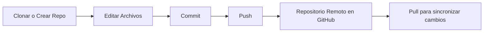

# 🧑‍💻 Tutorial de GitHub Desktop

## 🏁 Introducción

**GitHub Desktop** es una aplicación oficial de GitHub que permite trabajar con repositorios de Git mediante una **interfaz gráfica**, evitando el uso directo de la línea de comandos.

---

## 📥 1. Instalación

### 🔹 Paso 1: Descargar

Visita la página oficial:  
👉 [https://desktop.github.com](https://desktop.github.com)

Haz clic en el botón **Download for Windows** o **Download for macOS**, según tu sistema operativo.

### 🔹 Paso 2: Instalar

1. Abre el instalador descargado.  
2. Sigue los pasos del asistente (no requiere configuración avanzada).  
3. Una vez finalizada la instalación, abre **GitHub Desktop**.

---

## 🔐 2. Iniciar sesión en GitHub

1. Al abrir la aplicación por primera vez, te pedirá **iniciar sesión con tu cuenta de GitHub**.  
2. Haz clic en **Sign in to GitHub.com**.  
3. Se abrirá una ventana del navegador; autoriza la aplicación.  
4. GitHub Desktop se conectará automáticamente con tu cuenta.

---

## 📂 3. Clonar un repositorio

1. Ve a **File → Clone repository...**  
2. Elige una de las pestañas:
   - **GitHub.com**: selecciona un repositorio existente en tu cuenta.
   - **URL**: pega la URL de un repositorio remoto. En nuestro caso tienes que utilizar la URL dada por el github clasroom que sera de la forma xxxx.git
3. Selecciona la carpeta donde quieres guardar el proyecto localmente.
4. Haz clic en **Clone**.

---

## 🧾 4. Realizar cambios y commits

### 🔹 Paso 1: Editar archivos

- Abre el proyecto con tu editor (para VS Code, ver la siguiente guia).
- Realiza los cambios que desees (crear, modificar o eliminar archivos).

### 🔹 Paso 2: Ver los cambios en GitHub Desktop

- Regresa a **GitHub Desktop**.  
- Verás todos los cambios en la pestaña **Changes** (lado izquierdo).

### 🔹 Paso 3: Escribir un mensaje de commit

- En la parte inferior izquierda, escribe:
  - Un **mensaje corto y descriptivo** del cambio (por ejemplo: “Agrega función de login”).
  - Opcionalmente, una **descripción más detallada** en el cuadro de abajo.

### 🔹 Paso 4: Confirmar los cambios (Commit)

Haz clic en **Commit to main**.

👉 Esto guarda tus cambios localmente en tu repositorio, pero **aún no los sube a GitHub**.

---

## ☁️ 5. Subir cambios al repositorio remoto (Push)

Después de hacer uno o varios commits:

1. Haz clic en el botón **Push origin** (parte superior de la ventana).  
2. GitHub Desktop enviará tus commits al repositorio remoto en GitHub.  

✅ Ahora tus cambios están sincronizados en línea.

---

## 🔄 6. Descargar los últimos cambios (Pull)

Si trabajas con otras personas o desde otra máquina:

1. Haz clic en el botón **Fetch origin** (verifica si hay cambios nuevos).  
2. Si existen, aparecerá un botón **Pull origin**.  
3. Haz clic en **Pull origin** para traer los últimos cambios del repositorio remoto a tu versión local.

---

## 🧠 7. Resumen visual del flujo de trabajo

---

## 💡 8. Consejos finales

- Haz **commits pequeños y frecuentes**.
- Usa mensajes de commit descriptivos.
- Sincroniza (Push/Pull) regularmente para evitar conflictos.
- Puedes usar **“Undo”** en GitHub Desktop si te equivocas en un commit reciente.
